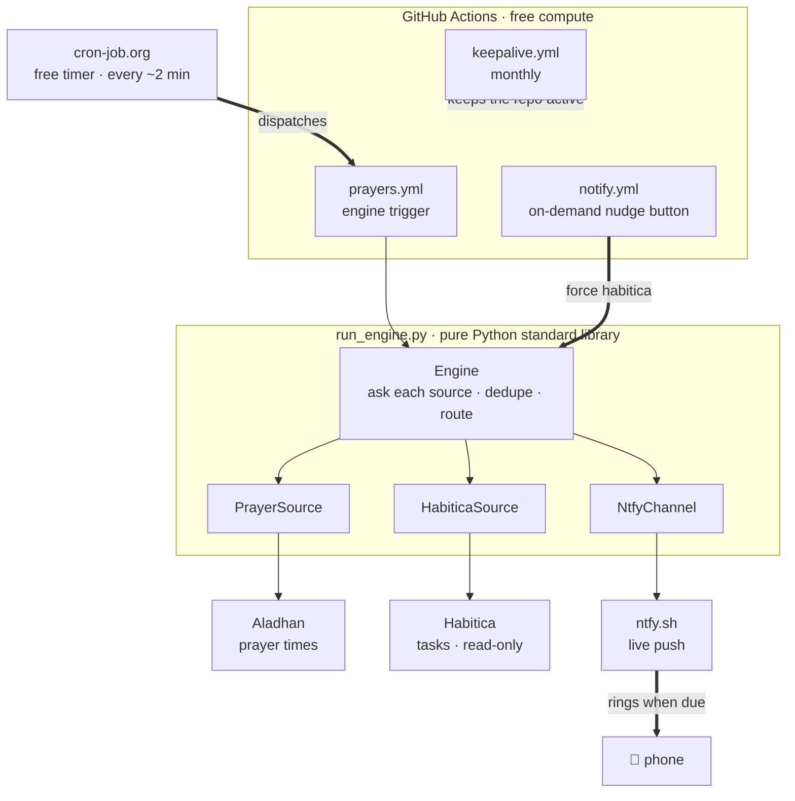

# Architecture

NoterPiper is a serverless **notification engine**: a small core plus pluggable
sources, delivered to your phone with no server, no cost, and no dependencies. It
ships with two plugins — **prayer reminders** and an optional **Habitica nightly
nudge** — and new ones drop in without touching the core.

## The shape: three decoupled layers

| Layer | Responsibility | Today |
|---|---|---|
| **Sources** (plugins) | decide *what* to notify, and *when* | `prayer`, `habitica` |
| **Engine** | asks each source what's due, de-dupes, routes | `engine/engine.py` |
| **Channels** | decide *how* to deliver | ntfy |

The engine depends only on the `Source` and `Channel` *interfaces*, never on a
concrete plugin — which is what lets new sources plug in untouched (Dependency
Inversion). Full design + how to write a plugin: **[PLUGINS.md](PLUGINS.md)**.

## How it works

**The run** — every ~2 minutes, cron-job.org dispatches `prayers.yml`, which runs
`run_engine.py`:

1. Load settings and map them into each plugin's **config slice** (`config.json` stays
   flat, so the phone page is unaffected).
2. `Engine.run(now, config)` asks **every source** `check(now, slice) → [Notification]`.
3. Each due notification is delivered **once** through `NtfyChannel` — ntfy's own
   recent-message cache is the "already sent today" store (no database needed).

A source or a single delivery that fails is isolated, so one can never stop the
others. The on-demand **"send now"** button (`notify.yml`) runs the same entry point
with `FORCE_SOURCE=habitica`, firing just the nudge immediately.

## Why this is a good build

- **Serverless & free.** Nothing to host, pay for, or patch. GitHub Actions is the
  compute, a free external timer is the clock, ntfy is delivery, Habitica/Aladhan are
  the data.
- **Extensible by design.** A new reminder type is one class satisfying the `Source`
  contract, registered in `run_engine.py` — the engine never changes (Open/Closed).
- **Live & self-correcting.** Settings are re-read every run, so a change applies in
  minutes. A configurable due-window plus ntfy-cache de-dup means a late or skipped
  tick is caught by the next run, never double-sending.
- **No dependencies.** Pure Python standard library — nothing can rot or need upgrades.
  (`pytest` only runs the tests.)
- **Resilient by construction.** All HTTP goes through one layer with retries +
  backoff (no pointless retry on a genuine 4xx). Failed runs email you — fails loudly.
- **Dependable trigger.** GitHub's own `cron` can stall on a quiet repo, so the engine
  is driven by an external free timer calling `workflow_dispatch`, which GitHub honours.

## Components

| Path | Role |
|---|---|
| `scripts/run_engine.py` | Entry point — map settings → slices, run the engine |
| `src/noterpiper/engine/types.py` | `Notification` — the immutable value object every layer passes |
| `src/noterpiper/engine/plugin.py` | `Source` — the plugin contract (`id` + `check`) |
| `src/noterpiper/engine/channel.py` | `Channel` — the delivery contract (`send` + `already_sent`) |
| `src/noterpiper/engine/engine.py` | `Engine` — the orchestrator loop |
| `src/noterpiper/channels/ntfy.py` | `NtfyChannel` — delivery + once-per-day dedup |
| `src/noterpiper/plugins/prayer/` | `PrayerSource` (+ its README) |
| `src/noterpiper/plugins/habitica/` | `HabiticaSource` (+ its README) |
| `src/noterpiper/net.py` | Resilient HTTP (retries, backoff) — the only network layer |
| `src/noterpiper/api.py` | Read-only Habitica client (optional) |
| `src/noterpiper/config.py` · `settings.py` | Env/`.env` access · `config.json` → typed `Settings` |
| `config.json` | Owner-editable settings (flat), mapped into plugin slices at run time |
| `docs/` | Phone config page (GitHub Pages) — edits `config.json` via the GitHub API |
| `.github/workflows/*` | `prayers` (engine trigger) · `notify` (nudge button) · `keepalive` · `ci` |

## Writing a plugin

A plugin is one class with an `id` and `check(now, config) → list[Notification]`. Add
it to `SOURCES` in `run_engine.py` and give it a config slice. Nothing else changes —
see **[PLUGINS.md](PLUGINS.md)** and the two plugin READMEs
([prayer](src/noterpiper/plugins/prayer/README.md),
[habitica](src/noterpiper/plugins/habitica/README.md)) for worked examples.

## Editing from your phone

`docs/` is a static page served by GitHub Pages (no build, no libraries). It reads
`config.json` publicly and writes it back through the GitHub Contents API using a
fine-grained token you paste once, kept only in your browser. Changes apply within a
few minutes — the engine re-reads settings every run. The nudge can also be fired on
demand via `workflow_dispatch`.
