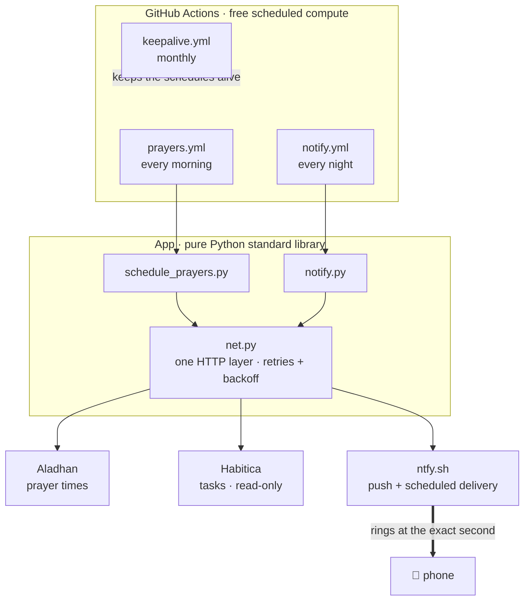

# Architecture

A minimal, serverless notification system: **prayer-time reminders + one nightly
nudge**, delivered to your phone — with no server, no cost, and no dependencies.

## Features

- **Precise prayer reminders** — your phone rings at each prayer's time (configurable
  per prayer: minutes before it ends, or after it starts), using live prayer times
  for your city.
- **One nightly nudge** — a single end-of-day check: what's still unlogged, and which
  streaks are at risk. Deliberately the *only* supplementary notification.
- **Editable without code** — timings live in `reminders.json`; city is one variable.
- **Runs itself** — scheduled on GitHub's infrastructure; your devices stay off.

## How it works

**The data flow:**
- *Mornings* — `schedule_prayers.py` fetches today's prayer times (Aladhan), computes
  each reminder, and **pre-schedules** them on ntfy with an exact `At` timestamp.
- *Nights* — `notify.py` reads your Habitica tasks (read-only) and sends one nudge.
- `net.py` is the single network layer every call goes through.

## Why this is a good build

- **Serverless & free.** There is nothing to host, pay for, or patch. GitHub Actions
  is the scheduler and compute, ntfy is delivery, Habitica/Aladhan are the data. Zero
  infrastructure, zero cost.
- **Precision is decoupled from compute.** GitHub's cron can drift by minutes — and it
  doesn't matter. The morning job only needs to run *sometime*; it hands ntfy
  pre-timed messages, and **ntfy delivers to the exact second.** Timing accuracy lives
  in the delivery layer, not the scheduler.
- **No dependencies.** The entire app is the Python standard library, so no package
  can rot, break, or require upgrades. (`pytest` is used only to run the tests.)
- **Resilient by construction.** All HTTP goes through one layer with retries +
  exponential backoff (and no pointless retry on a genuine 4xx). Each send/nudge is
  isolated with `try/except`, so a single failure never cascades. Failed runs email
  you — it fails loudly, not silently.
- **Self-sustaining.** A monthly keepalive commit stops GitHub from pausing scheduled
  workflows after 60 idle days.
- **Minimal surface area.** 3 scripts, 3 library files, 3 workflows. Small enough to
  read in one sitting, which is itself a reliability feature.

## Components

| File | Role |
|---|---|
| `scripts/schedule_prayers.py` | Fetch prayer times → compute reminders → schedule on ntfy |
| `scripts/notify.py` | Read Habitica tasks → run nudges → send one notification |
| `src/muezzin/net.py` | Resilient HTTP (retries, backoff) — the only network layer |
| `src/muezzin/api.py` | Read-only Habitica client (optional) |
| `src/muezzin/config.py` | Settings from env / `.env` |
| `reminders.json` | Owner-editable reminder timings |
| `.github/workflows/*` | `prayers` · `notify` · `keepalive` |

## Extending it

**Reminder timings** — edit `reminders.json` (`before_end` / `after_start` minutes per
prayer). Takes effect next run; editable from GitHub's web UI.

**City** — set the `PRAYER_CITY` variable.

**A new nudge** — only if it clears the "worth a buzz?" bar. Write a function in
`notify.py` returning lines, add it to `NUDGES`; a failing nudge can't affect the
others. The mechanism is there, but **restraint is the rule** — more notifications
mean less signal.
