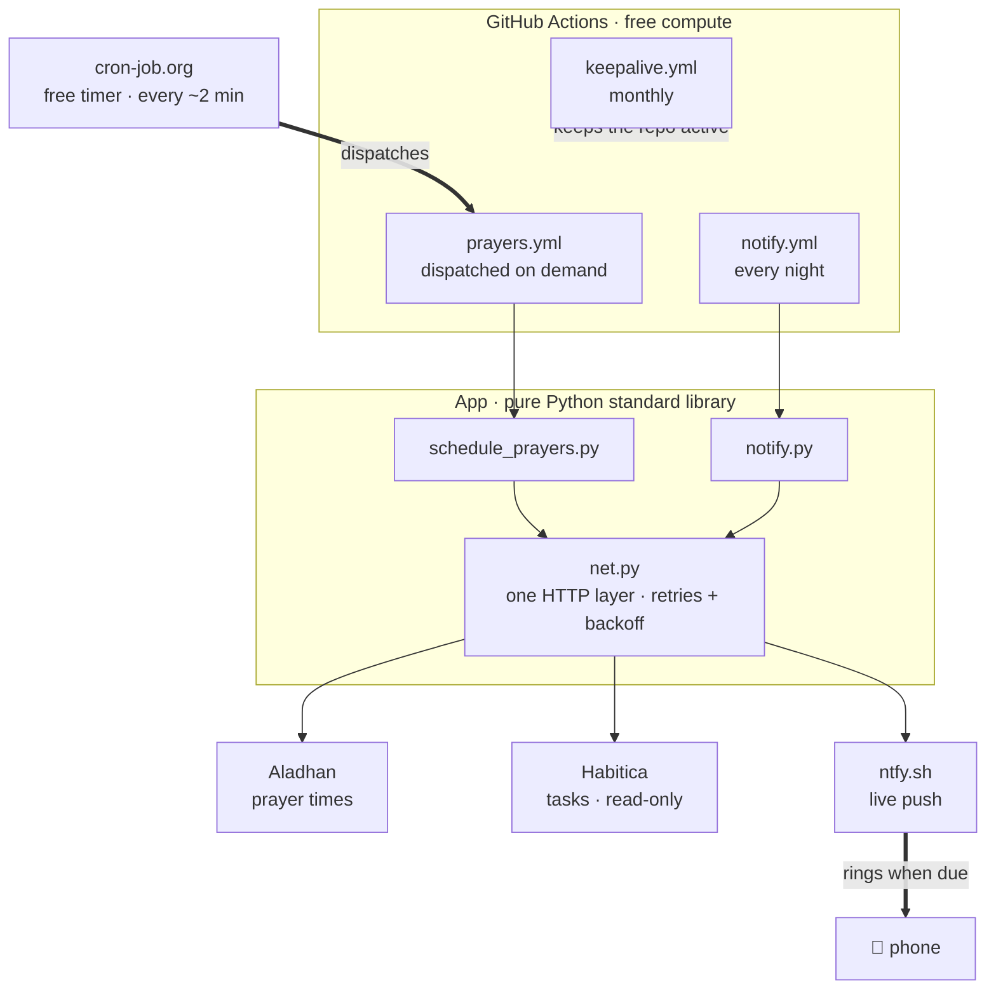

# Architecture

A minimal, serverless notification system: **prayer-time reminders + one nightly
nudge**, delivered to your phone — with no server, no cost, and no dependencies.

## Features

- **Precise prayer reminders** — your phone rings at each prayer's time (configurable
  per prayer: minutes before it ends, or after it starts), using live prayer times
  for your city.
- **One nightly nudge** *(optional)* — a single end-of-day check of what's still
  unlogged and which streaks are at risk, if you track habits in Habitica.
- **Editable without code** — location, timings, and the nudge all live in `config.json`.
- **Runs itself** — a free external timer triggers it; your devices stay off.

## How it works

**The data flow:**
- *Every ~2 min* — cron-job.org dispatches `prayers.yml`. `schedule_prayers.py` reads
  `config.json` fresh, fetches today's prayer times (Aladhan), and sends any reminder
  that is **due now** straight to ntfy. ntfy's own message cache de-dups, so each
  reminder goes out once.
- *Nights* — `notify.py` reads your Habitica tasks (read-only) and sends one nudge.
- `net.py` is the single network layer every call goes through.

## Why this is a good build

- **Serverless & free.** There is nothing to host, pay for, or patch. GitHub Actions
  is the compute, a free external timer (cron-job.org) is the clock, ntfy is delivery,
  Habitica/Aladhan are the data. Zero infrastructure, zero cost.
- **Live & self-correcting.** Because every run reads `config.json` fresh, a settings
  change applies within minutes — no waiting for the next day. The 20-minute due window
  plus ntfy-cache de-dup means a late or skipped tick is caught by the next run,
  without ever double-sending. (Trade-off: timing is "within a few minutes," not
  to-the-second — the check runs on an interval, not at the exact moment.)
- **No dependencies.** The entire app is the Python standard library, so no package
  can rot, break, or require upgrades. (`pytest` is used only to run the tests.)
- **Resilient by construction.** All HTTP goes through one layer with retries +
  exponential backoff (and no pointless retry on a genuine 4xx). Each send/nudge is
  isolated with `try/except`, so a single failure never cascades. Failed runs email
  you — it fails loudly, not silently.
- **Dependable trigger.** GitHub's own `cron` can stall on a quiet repo, so the
  prayer run is driven by an external free timer calling `workflow_dispatch` instead —
  which GitHub honours reliably. (A monthly keepalive commit keeps the repo active too.)

## Components

| File | Role |
|---|---|
| `scripts/schedule_prayers.py` | Fetch prayer times → compute reminders → send any due now to ntfy |
| `scripts/notify.py` | Read Habitica tasks → run nudges → send one notification |
| `src/noterpiper/net.py` | Resilient HTTP (retries, backoff) — the only network layer |
| `src/noterpiper/api.py` | Read-only Habitica client (optional) |
| `src/noterpiper/config.py` | Secrets from env / `.env` |
| `src/noterpiper/settings.py` | Reads `config.json` → typed `Settings` (env > file > default) |
| `config.json` | Owner-editable: location, offsets, nudge — the single source of truth |
| `docs/` | Phone config page (GitHub Pages) — `index.html` + `app.js`, edits `config.json` via the GitHub API |
| `.github/workflows/*` | `prayers` · `notify` · `keepalive` · `ci` |

## Extending it

**Reminder timings** — edit `config.json` (`reminders`: `before_end` / `after_start`
minutes per prayer). Takes effect next run; editable from GitHub's web UI.

**City** — edit `city` / `country` in `config.json`.

## Editing from your phone

`docs/` is a static page served by GitHub Pages (no build, no libraries). It reads
`config.json` publicly (no auth) and writes it back through the GitHub Contents API
using a fine-grained token you paste once, stored only in your browser. The nightly
nudge can also be fired on demand via `workflow_dispatch`.

Changes apply **within a few minutes**: the prayer job is dispatched every ~2 min and
reads `config.json` fresh each time, and the nudge reads it when it runs. The trade-off
for that liveness is timing precision — reminders land within a few minutes of the
target, not to the exact second, because the check runs on an interval.
