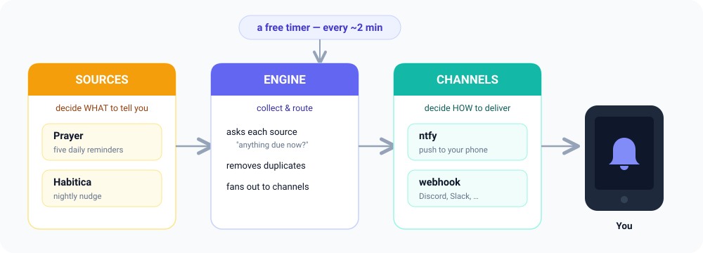

# NoterPiper

**A free, serverless notification engine — the right message, on your phone, at the right moment.**

---

## What it is, in one breath

NoterPiper quietly watches a few things for you and pings your phone when something's
due — starting with your **five daily prayers** and an optional **nightly Habitica
check-in**. It runs entirely on free services, needs no server, and is built so you can
add your own reminders (gym, water, anything) **without rewriting it**.

## How it works — the whole idea in one picture

**Think of it as a tireless assistant.** Every couple of minutes, it walks down a short
checklist and asks each helper one question — *"anything I should tell them right now?"*

- 🟡 **Sources** are the helpers — they decide **what** to tell you. The *prayer* source
  says "yes, Maghrib is due"; a *gym* source might say "nothing yet."
- 🟣 The **engine** is the assistant — it just **collects** the answers and makes sure
  you're never told the same thing twice.
- 🟢 **Channels** are the messengers — they decide **how** it reaches you: the ntfy app,
  Discord, Slack, email…

The trick that makes it an *engine*: the assistant never knows **what** a helper does or
**how** a messenger delivers — only *"ask"* and *"hand off."* That's why a brand-new
reminder, or a new app to receive on, slots in **without the engine changing at all.**

> If you understand that picture, you understand NoterPiper. Prayer and Habitica are just
> the first two helpers; ntfy and webhook are just the first two messengers.

## Read the docs in this order

| # | Doc | What you'll get |
|---|---|---|
| 1 | **README** (you're here) | The idea and the big picture |
| 2 | **[SETUP](SETUP.md)** | Get it running on your phone — about 10 minutes |
| 3 | **[PLUGINS](PLUGINS.md)** | The plugins & channels, and how to add your own |
| 4 | **[ARCHITECTURE](ARCHITECTURE.md)** | The engine in depth |
| 5 | **[DECISIONS](DECISIONS.md)** · **[SECURITY](SECURITY.md)** | The *why*, and what's safe |

Each plugin also has its own short guide:
**[prayer](src/noterpiper/plugins/prayer/README.md)** · **[habitica](src/noterpiper/plugins/habitica/README.md)**.

## The ideas it's built on

A few well-worn software principles are what keep it simple — in plain words:

- **Decoupling (dependency inversion)** — the engine talks to *ideas* ("a source", "a
  channel"), never to Prayer or ntfy directly. The parts don't lean on each other.
- **Open to extend, closed to change** — add a plugin or channel without editing the engine.
- **Single responsibility** — each part has one job: a source decides *what*, the engine
  *routes*, a channel *delivers*.
- **Strategy** — channels are interchangeable delivery strategies; swap or add freely.
- **Plugin registry** — plugins are just a list the engine loops over.
- **Value object** — a *Notification* is plain, unchangeable data handed between the parts.

Together: **loose coupling, high cohesion** — self-contained pieces joined by thin glue.

## Get started

About ten minutes, once — then it runs itself.

### **→ Follow [SETUP](SETUP.md).**

## What it ships with

| Kind | Name | What it does |
|---|---|---|
| 🟡 Source | **prayer** | Rings for each of the five daily prayers |
| 🟡 Source | **habitica** *(optional)* | One calm nightly "what's left" nudge |
| 🟢 Channel | **ntfy** | Push to your phone |
| 🟢 Channel | **webhook** | POST to Discord, Slack, Home Assistant, any URL |

Built to run quietly for years. 🤲

