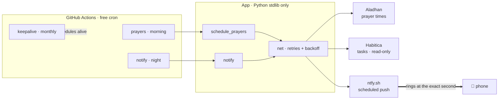

<div align="center">

# 🕌 Muezzin

**Your call to prayer — on your phone.**

*Precise prayer-time reminders and a nightly Habitica nudge. Serverless, free, and zero dependencies.*


</div>

---

## ✨ What it does

| | Feature | Detail |
|:--:|---|---|
| 🔔 | **Prayer reminders** | Your phone **rings at each of the 5 prayer times** — e.g. 30 min before a prayer ends — using live prayer times for **any city** (timezone auto-detected). Needs no Habitica. |
| 🌙 | **One nightly nudge** *(optional)* | If you use Habitica: a single end-of-day check — what's still unlogged and which streaks are at risk. |

> No dashboards, no spam. Notifications are kept **deliberately minimal** so they stay meaningful.

---

## 🧠 How it works

A **morning job** fetches today's prayer times and **pre-schedules** the reminders on
[ntfy](https://ntfy.sh) at exact times. A **nightly job** reads your Habitica tasks and
sends the nudge. Because ntfy handles exact-time delivery, GitHub's loose cron timing
never matters.



Deeper design notes: **[ARCHITECTURE.md](ARCHITECTURE.md)**.

---

## 🚀 Setup

Ten minutes, once — full steps in **[SETUP.md](SETUP.md)**:

1. Install **ntfy** on your phone and subscribe to a private topic.
2. On GitHub, add the `NTFY_TOPIC` secret and your `PRAYER_CITY` variable.
3. Enable **Actions**. Done — it runs itself.

---

## ⚙️ Configuration

| Change | Where |
|---|---|
| **Reminder timings** | `reminders.json` — `before_end` / `after_start` minutes per prayer (editable from GitHub's web UI) |
| **Location** | variables `PRAYER_CITY`, `PRAYER_COUNTRY`, `PRAYER_METHOD` (timezone is auto-detected) |
| **Habitica nudge** | optional — set `HABITICA_API_TOKEN` + `HABITICA_USER_ID` to enable it |

Full setup in **[SETUP.md](SETUP.md)** · security notes in **[SECURITY.md](SECURITY.md)**.

<details>
<summary>Example — what the notifications look like</summary>

```
Prayer reminder     Asr
                    Time to pray · ends 3:14 PM

Nightly nudge       Before midnight
                    Prayers left: Asr, Maghrib, Isha
                    Not done: Morning dhikr
                    Streak at risk: Daily Quran (42)
```
</details>

---

## 🛡️ Why it lasts

- **Serverless & free** — nothing to host, pay for, or patch.
- **Precision decoupled from compute** — the scheduler can drift; ntfy still delivers to the exact second.
- **Zero dependencies** — pure standard library; no package can rot or break it.
- **Resilient** — one retrying HTTP layer, isolated failures, loud (emailed) on error.
- **Self-sustaining** — a monthly keepalive stops GitHub pausing the schedules.

---

## 🔒 Privacy

Read-only Habitica access. The API token lives as a GitHub secret — never committed,
printed, or exposed (`.env` and `data/` are git-ignored). Private repo.

<div align="center"><sub>Built to run for years, hands-off. 🤲</sub></div>
