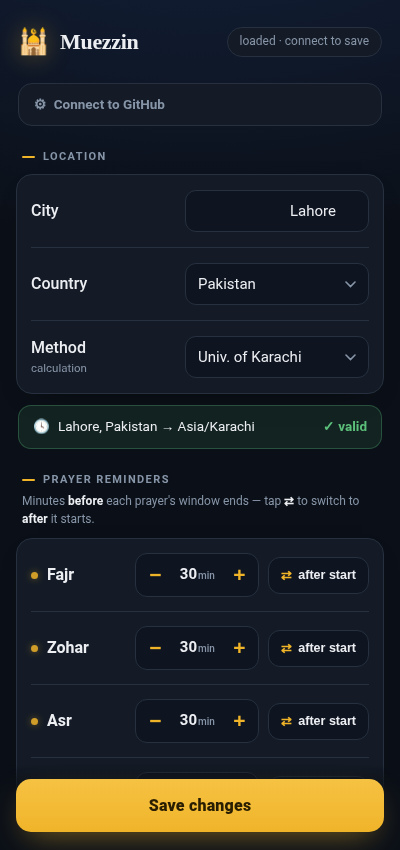

# 🕌 NoterPiper

**Your call to prayer — on your phone.**

*Gentle prayer reminders and a quiet nightly check-in. Free, private, and it runs itself.*

 

---

## What it does

🔔 **Prayer reminders** — your phone rings for each of the five prayers, at the
moment *you* choose within that prayer's own window.

🌙 **A nightly check-in** *(optional)* — one calm end-of-day reminder of what's
left, if you keep your habits in Habitica.

📱 **A little app** — set your city and your reminder times from your phone,
whenever you like. Changes take effect within minutes.

No servers. No sign-ups. No cost.

---

## What lands on your phone

> ### 🕌 Maghrib
> Time to pray · ends 5:03 PM

One ring, when it matters — clear and to the point. Nothing else, ever.

---

## How it works

You choose your city and your timings once. From then on, a small job quietly
checks the clock every few minutes and rings your phone the moment a prayer is
due — on time, every day, with nothing to keep running on your end.

---

## Get started

About ten minutes, once — then it looks after itself.

### **→ Follow the three steps in [SETUP](SETUP.md).**

That's genuinely all there is to it.

---

## Why you can trust it

- **It lasts.** Nothing to host, pay for, or patch — built to run for years untouched.
- **It's private.** It only ever *reads* your data, and nothing personal leaves your own copy.
- **It's on time.** It checks continuously, so a change you make shows up in minutes.

---

Built to run quietly for years. 🤲

